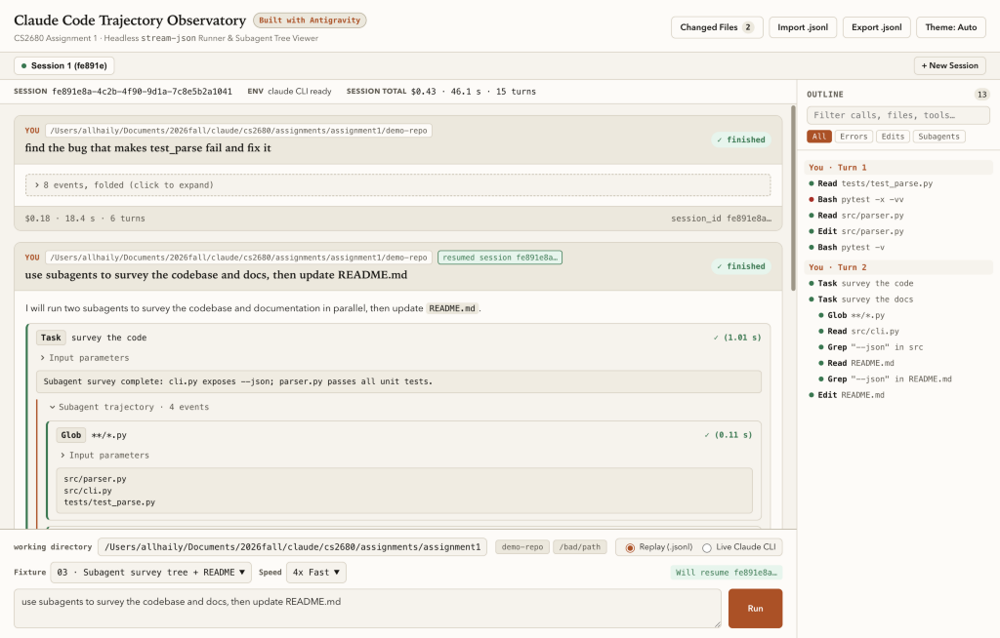

# CS2680 Assignment 1 Writeup — Experience a Coding Agent

> **Development Attribution:** Unlike the suggested workflow of using Claude Code to build the frontend, **this entire Assignment 1 application (backend, frontend, tests, and fixtures) was developed using Google DeepMind Antigravity** (assisted by the `Modern Web Guidance` plugin) **rather than Claude Code**. The web application itself still drives headless `claude -p --output-format stream-json --verbose` subprocesses and replays recorded `stream-json` trajectories exactly as required by the specification.

---

## 1. What I Built

I built **Claude Code Trajectory Observatory**, a zero-dependency Node.js and Vanilla ES Modules web observer that launches headless `claude -p --output-format stream-json --verbose` runs (or replays recorded `.jsonl` captures over Server-Sent Events) against a target directory, parses NDJSON events incrementally in a shared state reducer (`trajectory-model.js`), and renders formatted Markdown, paired `tool_use`/`tool_result` cards with 8-line output folding, per-call and per-run failure states, `--resume` session continuity, dollar/duration/turn metrics, and collapsible `parent_tool_use_id` subagent trees paired with a side-by-side interactive outline.

Improvements beyond the seven required features:

- **Live `Stop` cancellation**: Terminates an active headless `claude` child process (`SIGTERM` with `SIGKILL` fallback) or replay timer and transitions lingering `pending` tool calls to `interrupted` instead of leaving the UI stuck.
- **Inline `Edit` unified diffs & Changed Files `<dialog>`**: Computes line-level diffs on `Edit`/`MultiEdit`/`Write` inputs inline and aggregates every modified file in the session inside a light-dismiss modal dialog.
- **Replay Studio with `.jsonl` import/export**: Supports `1x`, `4x`, and `Instant` replay speeds across bundled scenarios, custom `.jsonl` paste/file upload, and downloading any live or replayed trajectory as raw NDJSON.
- **Parallel session tabs & Outline filtering**: Allows running an isolated failing check (e.g. `/bad/path`) in a second tab without interrupting an active session, and filtering the trajectory outline by `All`, `Errors`, `Edits`, `Subagents`, or keyword search.
- **Permission mode selector & `ANTHROPIC_API_KEY` guard**: Switches between `--dangerously-skip-permissions` and scoped `--allowedTools` patterns while surfacing a banner if `ANTHROPIC_API_KEY` is exported in the server environment.

---

## 2. What I Learned

1. **How the agent works (proactive environment reconnaissance before coding)**  
   Before writing a single application file in Antigravity, the agent checked local git state, filesystem behavior, and binary paths. It caught `core.ignorecase=true` on macOS APFS and renamed the existing lowercase `readme.md` spec to `SPEC.md` via `git mv` before creating `README.md` so the assignment instructions would not be silently overwritten. It also probed `~/.nvm/versions/node/` and found `claude` installed under `v18.17.0` even though Node `v24.14.1` was active and `which claude` initially failed—something I would have overlooked until runtime.

2. **A pitfall (CSS flex compression in pinned layouts + non-interactive `PATH` resolution)**  
   Visual verification of the live UI at `1440x920` exposed two subtle bugs that unit tests could not catch:
   - First, `.btn { display: inline-flex }` beat the user-agent `[hidden]` attribute in CSS specificity, leaving the red `Stop` button visible even when idle until fixed with `[hidden] { display: none !important; }`.
   - Second, after pinning `.app-shell` to `100dvh` so the header and composer stayed fixed, `.run-card` elements inside the flex-column `#trajectory-feed` had `overflow: hidden` without `flex-shrink: 0`. Flexbox relaxed `min-height: auto` to `0` and compressed Turn 1 down to its `70.8px` header, clipping its fold toggle and metrics footer until `flex-shrink: 0` restored intrinsic card sizing (`scrollHeight: 1293px` inside a `612px` scroll viewport).
   - Separately, invoking Node scripts with `#!/usr/bin/env node` inside restricted shells failed with `env: node: Operation not permitted`, reinforcing why `claude-runner.js` must prepend both `claude`'s directory and `path.dirname(process.execPath)` to the child `PATH`.

3. **A lesson (deterministic `.jsonl` fixtures + pure shared reducers)**  
   Writing `public/lib/trajectory-model.js` as a pure ES module shared between the browser UI and `node --test`—and building realistic `.jsonl` fixtures (`01-fix-bug.jsonl` with a 90+ line `pytest` error, `02-resume-followup.jsonl`, and `03-subagent-survey.jsonl` with nested `parent_tool_use_id` branches)—compressed UI and parser debugging into a 52 ms test cycle. It also surfaced protocol edge cases early, such as how `tool_result` blocks arrive inside `user` messages rather than `assistant` messages and how `run_error` exits must sweep orphaned `pending` tool calls to `interrupted`.

---

## 3. One Thing I Would Change About Claude Code

I would add **incremental `tool_result` streaming chunks** and an **explicit `--auth-mode` flag** to headless `claude -p --output-format stream-json`. Today, a long-running `Bash` command (such as a slow test suite or build) leaves its `tool_use` block `pending` in silence until the subprocess exits and emits one large `user` `tool_result` event at the end—forcing observers to guess whether a command is progressing or hung. Emitting lightweight `tool_progress` / stdout-delta events with the matching `tool_use_id` would make live observability genuinely real-time. Likewise, making credential selection explicit (`--auth-mode login|api-key`) instead of silently letting an ambient `ANTHROPIC_API_KEY` override stored subscription login would eliminate accidental API billing during headless automation.
