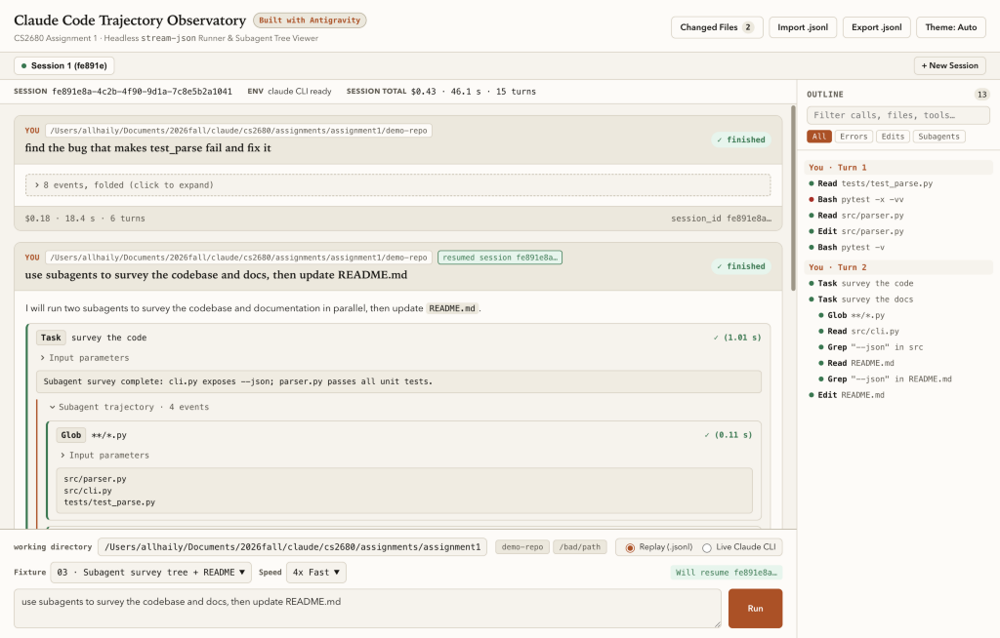

# CS2680 Assignment 1 实验报告（中文版）

> **开发工具声明：** 本作业的后端、前端、测试夹具与报告文档均使用 **Google DeepMind Antigravity**（结合 `Modern Web Guidance` 插件）开发完成，**未使用 Claude Code 进行开发**。但本 Web 应用本身严格按作业要求通过子进程驱动无头模式的 `claude -p --output-format stream-json --verbose` 并实时渲染事件流。

---

## 1. 我构建了什么（What I Built）

我构建了一个零外部依赖的 Node.js + 原生 ES Modules 网页应用 **Claude Code Trajectory Observatory**。后端通过子进程调用无头模式 `claude -p --output-format stream-json --verbose`（或回放本地录制的 `.jsonl` 流）并经由 SSE 实时推送；前后端共享纯状态归约模块 `trajectory-model.js`，逐事件流式渲染 Markdown 文本、按 `tool_use_id` 关联展示工具输入与超过 8 行自动折叠的工具输出、呈现工具调用与单次运行的双层状态及报错信息、携带 `session_id` 通过 `--resume` 连续多轮对话、展示每轮及会话累计费用/耗时/轮次，并在宽屏下将 `parent_tool_use_id` 嵌套的子代理树与右侧可交互轨迹大纲（Outline）并排显示。

在七项基本要求之外增加的实用改进：

- **实时 `Stop` 终止按钮**：通过 `SIGTERM`（2 秒后 `SIGKILL` 兜底）中止正在运行的 `claude` 子进程或回放定时器，并把未完成的 `pending` 工具调用标记为 `interrupted`。
- **行内 `Edit` Diff 与 Changed Files `<dialog>` 弹窗**：针对 `Edit`/`MultiEdit`/`Write` 自动计算行级统一差异，并在支持 light-dismiss（含 Safari 边界回退）的模态弹窗中汇总整个会话修改过的文件。
- **Replay Studio（`1x` / `4x` / `Instant` 回放 + `.jsonl` 导入导出）**：支持内置场景快速演示、粘贴或上传任意 `events.jsonl` 回放，以及将运行轨迹导出为 `.jsonl` 归档。
- **多会话并行标签页与大纲检索过滤**：支持新建标签页单独验证 `/bad/path` 失败场景而不打断主会话，并可按 `All` / `Errors` / `Edits` / `Subagents` 与关键词过滤轨迹大纲。
- **权限模式切换与 `ANTHROPIC_API_KEY` 误计费提醒**：支持切换 `--dangerously-skip-permissions` 与作用域受限的 `--allowedTools`，当环境变量中存在 `ANTHROPIC_API_KEY` 时在顶部给出警示条。

---

## 2. 我学到了什么（What I Learned）

1. **Agent 的工作方式（编码前先做环境侦察）**  
   使用 Antigravity 开发时，Agent 在动手写代码前先检查了本地 Git 配置与二进制路径：它注意到 macOS APFS 默认 `core.ignorecase=true`，如果直接写 `README.md` 会无声覆盖原有小写 `readme.md` 题目说明，于是先通过 `git mv` 将其保留为 `SPEC.md`；同时还排查出虽然当前 shell 中 `which claude` 找不到命令，但 `claude` 实际安装在 `~/.nvm/versions/node/v18.17.0/bin/claude`，避免了后续子进程直接报 `ENOENT`。

2. **踩过的坑（Flex 压缩裁剪与非交互式 `PATH` 缺失）**  
   在 `1440x920` 浏览器实机截图验证中发现了两个单元测试测不出的布局坑：
   - `.btn { display: inline-flex; }` 的优先级压过了浏览器默认的 `[hidden]` 属性，导致空闲时红色 `Stop` 按钮仍然显示，直到补上 `[hidden] { display: none !important; }` 才修复。
   - 把桌面外壳固定为 `100dvh` 后，内部纵向 Flex 容器 `#trajectory-feed` 里的 `.run-card` 因为同时设置了 `overflow: hidden` 且缺少 `flex-shrink: 0`，导致浏览器把 Turn 1 卡片压缩到只有头部高度（`70.8px`），把折叠栏和费用统计页脚截断了；加上 `flex-shrink: 0` 后内部容器正常产生滚动（`scrollHeight: 1293px` / `clientHeight: 612px`），两轮轨迹都能完整滚动查看。
   - 此外，当子进程继承的 `PATH` 缺少 Node 目录时，`#!/usr/bin/env node` 会直接失败，因此后端必须在 `spawn` 时显式把 `claude` 所在目录和 `path.dirname(process.execPath)` 拼入子进程 `PATH`。

3. **一条经验（确定性 `.jsonl` 夹具 + 共享纯 Reducer 先行）**  
   把事件流解析抽成无副作用的 `public/lib/trajectory-model.js`，先配合 3 份覆盖 90+ 行报错折叠、多轮 `--resume` 与 `parent_tool_use_id` 子代理树的 `.jsonl` 夹具用 `node --test` 在 50ms 级别跑通全部边界测试（包含异常退出时把残留 `pending` 调用置为 `interrupted`），再接入 UI 与真实浏览器验证，极大压缩了排查周期。

---

## 3. 如果能改进 Claude Code 的一件事

我会给无头模式 `claude -p --output-format stream-json` 增加**增量 `tool_result` 流式输出块**以及**显式的 `--auth-mode` 参数**。目前执行耗时的 `Bash` 命令（如长测试或编译）时，界面只能看到一个静止的 `pending` 状态，直到命令完全退出才会一次性收到打包在 `user` 消息里的 `tool_result`；如果能按 `tool_use_id` 持续推送增量 stdout/stderr 事件，前端就能真正实现命令执行过程的可观测性。同时，增加显式 `--auth-mode login|api-key` 开关，能防止环境变量里残留的 `ANTHROPIC_API_KEY` 在不知情的情况下覆盖订阅登录凭证造成意外扣费。
